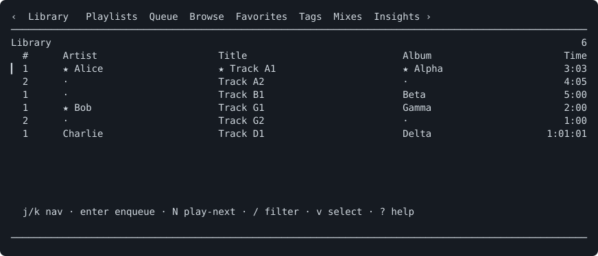

# muse

muse is a terminal music player for a local music library. It drives
[mpv](https://mpv.io) over a Unix IPC socket for playback, keeps a SQLite index
of your files built from [ExifTool](https://exiftool.org) or ffprobe metadata,
and renders everything through a
[Bubble Tea](https://github.com/charmbracelet/bubbletea)
TUI: eight primary views, a command palette, an in-app metadata editor, a
listening-insights dashboard, and a steerable Auto-DJ that keeps picking the
next track for you. It is keyboard-driven throughout — press `?` at any time for the
full keybinding reference.



## Quick start

1. Install **Go 1.26+**, **mpv**, and either **ExifTool** or **ffprobe**.
   On macOS: `brew install go mpv exiftool`. See [Requirements](#requirements)
   for Linux commands.
2. Install muse: `go install github.com/sglavoie/muse@latest`.
   If your shell cannot find `muse`, see the [PATH setup](#install).
3. Run `muse`, then press `ctrl+,` on the welcome screen to open Library
   settings. Press `a` to add a music directory, `Enter` to accept it, and
   `ctrl+s` to save and scan. You can also edit `music_directories` in
   `~/.config/muse/config.toml` (or `$XDG_CONFIG_HOME/muse/config.toml`).
   Invalid or duplicate directories keep the input open with an explanation
   so you can correct the path; `~` and relative paths are accepted.
4. Select a track and press `Enter` to enqueue
   it; the first queued track starts playback. Use `Space` to pause, `/` to
   filter, `3` to see the queue, and `?` for help. To diagnose setup problems,
   run `muse check` from a terminal.

The preview above uses fictional library data from the
[fixture harness](docs/tui-testing/README.md); it needs no music files or mpv.

## Features

**Eight primary views**, switched with `1`–`8`:

| View | What it does |
| --- | --- |
| **Library** (`1`) | The whole collection, with sub-modes for All / Recently Added / History. Filter with prefixes (`a:` artist, `t:` title, `l:` album, `g:` genre, `aa:` Album Artist). |
| **Playlists** (`2`) | Static playlists plus smart playlists driven by a rule editor (AND/OR over field/operator/value rules). `/` filters playlist names; open playlists also support `a:`, `t:`, `l:`, `g:`, and `aa:` field prefixes. |
| **Queue** (`3`) | The live play queue: reorder, remove, yank/cut/paste rows, save the queue as a playlist. |
| **Browse** (`4`) | Hierarchical browsing by Artists ↔ Albums ↔ Genres, drilling down to tracks. |
| **Favorites** (`5`) | Favorited tracks, albums, and artists, grouped by category. |
| **Tags** (`6`) | Free-form user tags with create / rename / delete / merge, undo, and a per-track tag picker. |
| **Mixes** (`7`) | Generated recommendation mixes — Rediscover, Hidden Gems, On Repeat, Deep Cuts — tuned by thresholds in `config.toml`. |
| **Insights** (`8`) | Listening statistics: sessions, momentum, discovery, and a data-health panel that surfaces colliding genre spellings, blank fields, and unverified durations. |

Albums are grouped by title and **Album Artist**. When Album Artist is missing,
muse uses the containing folder, keeping untagged compilations together. Album
rows show the artist or folder to distinguish releases with the same title.
Untagged discs in separate folders remain separate; a shared Album Artist tag
groups them across folders. Existing title-only album favorites apply to every
matching release, and each release can then be unfavorited independently.

**Playback**

- **Radio mode / Auto-DJ** (`A`) — muse keeps the queue fed by scoring
  candidate tracks against what you have been listening to, avoiding recent
  history. It can be seeded from a mix, from an Insights row, or from whatever
  you have selected (`:` → _Start Auto-DJ from selection_).
- **Steerable Auto-DJ** (`ctrl+a`) — a panel for steering the session while it
  plays, in three tabs:
  - **Tune** — a preset (Familiar 20%, Balanced 40%, Explore 80%, or Custom for
    anything you tune in between), the discovery percentage itself in ten-point
    steps, an anchor mode (`Anchor` keeps scoring against the track you started
    from, `Follow` re-anchors on every track change), and
    include/exclude filters on tags, genres, and artists. `ctrl+s` starts the
    session, or applies the draft to a session already running — the queue is
    then rebuilt in place, ahead of the track you are listening to, without
    interrupting it.
  - **Preview** — the batch the current draft would add, with the reason each
    track was picked, what was ruled out, and any shortage (say, "only 1 of 3
    familiar tracks were available; discovery tracks filled the rest"). It is
    read-only: looking at a draft never changes what is playing or queued.
  - **Recipes** — named settings you can save, update, rename, and delete.
    A recipe stores settings only, not a queue or a seed: saving one changes
    nothing that is playing, and loading one edits the draft, which you then
    start. Settings the panel can no longer resolve — a filter naming a tag you
    have since deleted — are shown as unusable rather than silently widened.

  The DJ only ever touches rows it added. Tracks you queued yourself are left
  alone by a re-tune, and so is the one playing. Radio mode and the tuned
  settings survive a restart: muse restores the session, its seed, and its
  discovery balance, and keeps filling from where it left off.
- **Queue duration at a glance** — the Queue header shows time remaining in the
  current batch, including shuffle order. Repeat, Auto-DJ, and stop-after modes
  label it as queued time rather than an end time; `+` marks unknown durations.
  The duration yields to filtering and selection details in narrow windows.
- The queue summary (`q`) updates while open, including track changes and
  duration corrections. Both remaining and total time use `+` for unknown durations.
  Album counts distinguish releases by Album Artist or folder, as Browse does.
- **Copy now-playing info** — a palette command copies the playing or paused
  song while you browse elsewhere; its detail line identifies the song.
- Focused-track copy and reveal commands identify their song or file path in
  the palette detail line. Search synonyms include “locate file,” “restart song,”
  and “errors” (Recent Messages).
- **Browse now-playing…** — a palette command opens artist, album, and genre
  destinations for the playing or paused song, independently of the focused row.
  Its detail line identifies the song; selecting it keeps that target even if
  playback advances while the palette is open.
- **Seek to time…** in the command palette jumps to seconds (`90`), `m:ss`
  (`12:30`), or `h:mm:ss` (`1:02:03`) in the loaded track, preserving pause.
  The dialog shows the current position and track duration, updating while open;
  unknown durations are labeled explicitly. Invalid times stay open for correction;
  changing tracks cancels the target.
- **Gapless playback** via mpv prefetch (`gapless_audio`).
- **10-band equalizer** with built-in presets (Flat, Bass Boost, Treble Boost,
  Rock, Jazz, Classical, Pop) and user-defined custom presets, plus stereo
  widening and EBU R128 volume normalization.
- **Desktop notifications** on track change, and a `muse now-playing` subcommand
  you can bind to a global hotkey.
- **Remote control** of a running instance from another terminal:
  `muse toggle-play`, `muse next`, `muse previous`, `muse volume-up`,
  `muse volume-down`.

**Library management**

- **Metadata editor** (`M`) — fix title, artist, album, Album Artist, and genre on the
  focused track. Edits are stored in muse's database, so your audio files are
  never modified. `i` shows the library values first and labels differing original
  file tags, followed by audio and file details from ExifTool or ffprobe.
  Use `j`/`k`, arrow keys, or Page Up/Down to scroll; `g`/`G` jumps to the
  beginning/end. Long values wrap, and the title shows your position when
  more information is available.
- The metadata form places Album Artist beside Artist and shows the original
  filename when there is room. Duration accepts seconds (`90`), `m:ss` (`1:30`),
  or `h:mm:ss`, matching Seek to time; its format hint appears while focused.
  An empty duration remains unknown.
- Saving an unchanged metadata form leaves your previous undo available.
  Changed fields are marked with `*` in single-track and bulk forms, with a
  changed-field count below the editor. Restoring an original value removes its marker.
  In single-track forms, `ctrl+r` restores the focused field to its opening
  value without changing other edits.
  Editing other fields preserves the precise track duration. Bulk forms label
  differing values as “Multiple values — unchanged”; untouched fields retain
  each track's original value. In bulk forms, `ctrl+d` explicitly clears the
  focused field for every selected track; `ctrl+r` restores that field to
  unchanged. Clear operations show “Will clear for N tracks” before saving
  and support undo.
- Edited metadata forms and Auto-DJ drafts ask before discarding changes on `Esc`.
  The default is **Keep editing**; choose **Discard changes** with Tab and Enter.
  Unchanged forms close immediately.
- Album Artist edits regroup albums immediately and support bulk editing, explicit
  clearing, and undo. Corrections survive rescans and restarts. TSV exports include
  `album_artist`; importing an older export without that column leaves it unchanged.
- Playlist footers show enqueue and back controls inside a playlist, with
  “enqueue focused” when rows are selected.
- Help keeps scrolling, search, scope, and close hints visible, with a scroll percentage.
- The palette’s **Clear selection** command describes the selected row count and
  how many are hidden, and clears only the current view’s selection.
- Track searches match base filenames consistently across views. Matching ignores
  case and Latin accents (`bjork` finds `Björk`), while displayed metadata retains
  its original spelling and highlights. Field prefixes still search only their
  named fields; directory names are excluded from filename matching.

- **Metadata export / import** — round-trip the visible view's rows through a
  TSV file in the data directory, for bulk cleanup outside the TUI. The palette
  shows the number of unique exportable tracks and whether it uses your selection
  or visible rows; at Browse collection level, its detail names the focused
  collection. Re-exporting keeps the previous file, including any external edits, as `metadata-export.tsv.bak`.
  Use the palette’s _Reveal previous metadata export backup_ command to locate it.
  To recover it, copy that backup over `metadata-export.tsv` before importing.
- The track tag picker accepts multiword names, with Enter to toggle or create
  and Space as normal text. A Create row remains available alongside partial
  matches unless the exact name already exists (ignoring case). Long lists scroll
  to keep the focused row visible; Page Up/Down moves a page and the heading
  shows the visible range.
- Bulk selection (`x` / `X`) and visual line selection (`v`) in every list view
  except Mixes, where `x` / `X` dismiss and restore a recommendation instead.
- Favorites selections survive filtering and sorting. Headings show selected and
  hidden counts; bulk actions include hidden selections. Navigating to another
  Favorites list clears the selection.
- Library and Queue selections show their total duration beside the count,
  including selected tracks hidden by filters. Queue counts each selected entry,
  including repeated songs. A separate hidden count shows how many
  selected tracks are outside the current list; scrolling alone does not change it.
  `+` marks unknown durations; the duration
  yields to other details in narrow windows.
- The palette's _Remove queue duplicates_ command previews how many repeated
  entries it will remove, keeping first occurrences. It is unavailable when
  the queue has no duplicates.
- Undo (`u`) for destructive operations. Queue, playlist, and tag undo failures
  appear in Recent Messages and can be retried within the original ten-second
  undo window. Bulk playlist and tag-assignment restores are atomic. The countdown belongs
  to the active undo prompt; unrelated messages do not inherit it.
- Enqueue confirmations distinguish “Queued next” from “Added to queue,” with
  the same undo shortcut for both.
- Clearing a text filter with `Esc` or the palette keeps the focused row in view; a search with no matches
  returns to your position before filtering. Library and Queue no-match hints
  distinguish `Esc` to clear a text filter from `ctrl+t` to clear a tag filter.
- While editing a filter, the footer shows `Enter` to apply, `Esc` to clear,
  and Up/Down to recall history. `/` is literal text while editing, so names
  such as `AC/DC` can be typed normally. Help search also treats `/` as literal
  text while typing; `Enter` applies the search and `Esc` clears it. Empty field
  prefixes such as `a:` leave tracks visible while you type; other populated terms still apply.
  When space allows, track-list filter editors also show
  how field prefixes were interpreted, such as `Artist: Miles Davis · Genre: Jazz`.
  Browse, Favorites, Tags, Queue, and open playlists support the same field
  prefixes, including `g:` / `genre:` and `aa:` / `albumartist:`, wherever
  individual tracks are listed. Album Artist filters match the stored Album Artist
  value, independently of the track artist; for example, `aa:Various Artists g:Jazz`.
  Collection-name filters continue to match literal text.
- **Recent filters** — while editing `/`, Up/Down recalls the last 20 distinct
  committed queries across views. Down past the newest restores your unfinished
  query. If saving history fails, Recent Messages reports it once until saving
  recovers; queries remain available for the current session. History survives
  restarts in `filter_history.json` in the data directory;
  cancelled queries are excluded, and startup does not apply a saved filter.
- The playlist destination picker supports `/` search, Page Up/Down, and
  `g`/`G` to jump to the first/last destination. Long lists scroll to fit the
  terminal. Search matches playlist names and keeps Play Queue and New playlist
  available. Enter applies the search, then confirms a destination; Esc clears
  the search before dismissing the picker.
  The heading shows the count and total duration of the tracks being added,
  including hidden selections; `+` marks unknown durations.
- Open playlists show their total entry count and duration, including repeated
  songs. Filtering preserves selected entries, which have their own duration
  and hidden-selection count;
  `+` marks unknown durations. Playlist palette commands identify their target;
  rename and rule editing apply at list level, while **Refresh smart playlist**
  re-evaluates the open smart playlist.
- Playlist filters preserve individual rows when the same song appears more than
  once. `Esc` clears the track filter before returning to the playlist list, where
  the previous name filter is restored. Reordering and shuffle-in-place require
  an unfiltered track list. `E` still enqueues the entire playlist.
  Failed order saves restore the previous order and appear in Recent Messages;
  shuffle confirms success after saving. Further order changes wait until the
  current save finishes.
- **Direct sorting** — search the palette for _Sort by_ to choose a field supported
  by the current view. The selected field and direction appear in its detail line.
  Sort fields and directions survive restarts in `sort_preferences.json` in the
  data directory. Library modes and collection/track levels remember separate
  preferences; cursors and filters are not saved by this feature. Choose
  _Sort by default order_ to reset a view. The existing sort-cycle and
  direction shortcuts remain available.
- Completed library scans replace progress with “Scan complete — N tracks” and
  retain that result in Recent Messages. Manual rescans also report added and
  missing track counts compared with the library before the scan; moving a file
  with unchanged content does not count as an addition or a disappearance.
  Rescan results wait for database writes, and save failures appear as errors
  with a retry hint in Recent Messages. Canceled and incomplete scans keep their
  distinct messages.
- **Recent messages** — `:` → _Show recent messages_ reopens the last 50 action
  results and errors from this session. Long messages wrap; `j`/`k` scroll, with
  a line position indicator for longer histories. `y` copies the complete snapshot
  newest first, including timestamps, without display wrapping.
  Errors use distinct banner styling and retain an `[error]` label in recent
  messages and copied history. File-manager errors include the affected path.
  Progress updates are excluded, and past messages do not reactivate their shortcuts.

**Supported audio formats**: `.aac`, `.ac3`, `.aif`, `.aifc`, `.aiff`, `.ape`,
`.au`, `.caf`, `.dts`, `.flac`, `.m4a`, `.m4b`, `.m4r`, `.mka`, `.mp2`, `.mp3`,
`.mp4`, `.mpa`, `.oga`, `.ogg`, `.opus`, `.snd`, `.w64`, `.wav`, `.wma`, `.wv`.

`.mp4` is a container that can hold video. muse plays every file as audio only,
but a music directory holding video files will index them; use `excluded_paths`
in the config to keep them out.

## Requirements

### mpv — required

Playback engine. muse talks to it over a Unix IPC socket.

```
macOS:  brew install mpv
Debian: apt install mpv
Fedora: dnf install mpv
```

### A metadata backend — one of ExifTool or ffprobe is required

Track metadata (title, artist, album, album artist, genre, duration, track and
disc numbers) is read during library scans by an external tool. muse picks one at startup and
logs which; `muse check` reports it too. Startup only fails if neither is
usable.

Being on `$PATH` is not enough for either backend: muse runs a version probe
against each candidate and only accepts one that answers. The probe is bounded
(ten seconds each), so a wedged executable is treated as unusable instead of
hanging startup on a blank terminal. The bound is deliberately generous rather
than tight — a healthy probe answers in milliseconds, but a cold or heavily
loaded machine can take seconds just to start the process, and wrongly
rejecting a working tool is worse than a slow startup.

#### ExifTool — recommended (fastest)

The default backend. It reads a whole batch of files in one process, which
makes it about **2.4x faster than ffprobe** on a real library (measured over 300
mp3/flac files: 819 ms vs 1.94 s, roughly 2.7 ms vs 6.5 ms per file). ExifTool
requires Perl.

```
macOS:  brew install exiftool
Debian: apt install libimage-exiftool-perl
Fedora: dnf install perl-Image-ExifTool
```

If `exiftool -ver` fails after installing, the Perl runtime or a required
module is missing — on Debian/Ubuntu, `apt install libimage-exiftool-perl`
pulls in what it needs. muse treats that broken install the same as no install
and falls back to ffprobe, with a warning, rather than refusing to start.

#### ffprobe — required if ExifTool is absent

Part of FFmpeg, so no Perl runtime is involved. Used as the metadata backend
whenever ExifTool is missing or broken; scans are slower but complete, and
ffprobe reports durations and disc numbers for some formats more accurately
than ExifTool does. An ffprobe that resolves on `$PATH` but cannot actually run
(`ffprobe -version` fails) is rejected the same way a broken ExifTool is, so it
never becomes the backend and quietly scans every track into placeholder
metadata.

Independently of metadata, ffprobe also powers the background duration-audit
pass that corrects track durations metadata got wrong. Without ffprobe that
audit is simply skipped.

```
macOS:  brew install ffmpeg
Debian: apt install ffmpeg
Fedora: dnf install ffmpeg
```

### Notification backend — optional

Needed only for desktop banners (`notify_on_track_change` and
`muse now-playing`). Notifications are opt-in, so a missing backend never
blocks startup — `muse check` reports it as a warning.

**macOS** uses [alerter](https://github.com/vjeantet/alerter):

```
macOS:  brew install alerter
```

**Linux** uses `notify-send` from libnotify:

```
Debian: apt install libnotify-bin
Fedora: dnf install libnotify
Arch:   pacman -S libnotify
```

## Install

muse is distributed through `go install` only. It requires **Go 1.26+**.

```sh
go install github.com/sglavoie/muse@latest
```

`go install` puts the binary in `$(go env GOBIN)` when `GOBIN` is set, and in
`$(go env GOPATH)/bin` otherwise — usually `~/go/bin`. That directory is not on
`$PATH` by default. If `muse` comes back as "command not found", resolve the
install directory and add it:

```sh
MUSE_BIN="$(go env GOBIN)"                       # empty unless GOBIN is set
[ -n "$MUSE_BIN" ] || MUSE_BIN="$(go env GOPATH)/bin"

echo "$MUSE_BIN"                                 # where go install wrote muse
export PATH="$PATH:$MUSE_BIN"                    # add to ~/.bashrc or ~/.zshrc
```

To build from a checkout instead (a fork, or an unreleased revision):

```sh
git clone https://github.com/sglavoie/muse
cd muse
go install .
```

Then verify your configuration and prerequisites:

```sh
muse check
```

`muse check` validates the config file, checks that your music directories
exist and contain supported audio, and runs a live, time-bounded invocation of
mpv and of each metadata backend to catch broken installs. It also reports which backend
a scan would use. It prints `ok` and exits 0 when everything is in order, and
prints actionable errors to stderr and exits 1 otherwise. Advisory problems
(such as a missing notification backend, or falling back from ExifTool to
ffprobe) are printed as warnings without failing the check.

## Configuration

muse follows the XDG base directory spec, falling back to macOS conventions
when the XDG variables are unset:

| Purpose | Linux | macOS fallback |
| --- | --- | --- |
| Config | `$XDG_CONFIG_HOME/muse/config.toml` (default `~/.config/muse/config.toml`) | `~/.config/muse/config.toml` |
| Database | `$XDG_DATA_HOME/muse/muse.db` | `~/Library/Application Support/muse/muse.db` |
| Log | `$XDG_STATE_HOME/muse/muse.log` | `~/.local/state/muse/muse.log` |
| Sockets and PID lock | `$XDG_RUNTIME_DIR/muse/` | a user-specific directory under `$TMPDIR` |

On first run muse creates the `muse` config directory with mode `0o700` and
writes a commented `config.toml` into it. The only setting you must change is
`music_directories`:

```toml
music_directories = ["/path/to/your/music"]
```

Everything else has a working default. See [`config.example.toml`](config.example.toml)
for the full annotated set of options — excluded scan paths, default volume,
log level, mpv socket path and extra flags, seek and volume increments,
status-message and volume-feedback durations, gapless audio, EQ presets and
bands, stereo widening, volume normalization, theme and primary color, footer
hints, track-change notifications, following the now-playing track in the
Queue panel, and the recommendation-mix thresholds.

Open **Settings** (`ctrl+,`) and choose **Display** (`[` from Library) to
change the theme. Use `h`/`l` or the arrow keys on **Theme** to select **Auto**,
**Dark**, or **Light**. Auto follows the terminal background and is the default.
Both presets paint the full application canvas and provide contrasting text,
row highlights, and status colors.

On **Primary color**, press `Enter` to enter a `#RGB` or `#RRGGBB` color.
Headings, active tabs, focus highlights, and progress use this color; text
accents adjust for readable contrast. The override applies to either preset.
Press `r` on that row, or submit an empty value, to restore the preset default
(blue: `#8ab4ff` for Dark, `#315fbe` for Light). Changes preview immediately;
`ctrl+s` saves and `Esc` cancels. While editing a color, `Esc` discards that
text edit first. For a quick switch, open the command palette (`:`), search for
**Toggle theme**, and press `Enter`. It switches between Dark and Light, saves
the choice, and keeps your primary color. From Auto, it switches to the opposite
of the currently displayed theme.

The same options are available in `config.toml`:

```toml
theme = "light" # auto, dark, or light
primary_color = "#7c3aed" # empty uses the preset default
```

Until `music_directories` points at something readable, muse still starts — it
opens on an empty library with an overlay telling you which file to edit.
Directories that later go missing (an unmounted drive, a renamed folder) are
reported as a warning and skipped for that scan; the tracks under them stay in
the database rather than being marked missing.

If something goes wrong, the log file is the place to look. A panic in
background work — the scan pipeline, the mpv event reader, a watcher — is
recorded there with its stack and does not take the process down, and a panic
in the TUI leaves a record there too, since the terminal has already been
restored by the time you see it. muse also cleans up after a previous crash:
an mpv process orphaned by one is shut down at the next startup.

### Running against a throwaway library

Because every path in the table above comes from the XDG variables, pointing
them at a scratch directory gives you a fully isolated instance — its own
config, database, log, and socket — without touching your real setup. This is
the way to try a different `music_directories`, or to see what a new user sees:

```sh
mkdir -p /tmp/muse-sandbox/{config,data,state,run}
XDG_CONFIG_HOME=/tmp/muse-sandbox/config \
XDG_DATA_HOME=/tmp/muse-sandbox/data \
XDG_STATE_HOME=/tmp/muse-sandbox/state \
XDG_RUNTIME_DIR=/tmp/muse-sandbox/run \
  muse
```

muse writes a fresh `config.toml` under the sandbox config directory on that
first run; edit its `music_directories` to point at the test library. Two
things to keep in mind:

- The values must be absolute paths. Per the XDG spec, a relative value is
  ignored and muse falls back to the normal default — that is, your real
  config.
- `XDG_CONFIG_HOME` also redirects mpv's own config, so the sandbox instance
  will not pick up your personal mpv settings.

Setting `XDG_RUNTIME_DIR` matters when a real instance is already running: it
keeps the sandbox on a separate control socket and PID lock instead of talking
to the live process.

## Usage

Unavailable command-palette entries explain what
you need to select or open before using them. Focus a toggle command to see its
current setting in the palette’s detail line. Undo describes the change it will
reverse and is unavailable when its undo window has expired.

Queue commands describe their target in the palette's detail line. Library enqueue
reports the selected-track count; Play next and Replace queue identify the focused
track and explicitly say when a bulk selection will not be used. Replace also
states that it clears the queue. Commands needing a track are unavailable at
collection level or when there are no matching tracks.
The metadata command follows the same targets as `M`, including artist and album
renaming in Browse, bulk selections, and Data Health findings. Its detail line
identifies the track or shows the affected track count.
Palette search also accepts synonyms such as `refresh library`, `EQ`, and
`tune radio`; matches against displayed command names rank first. Seek and volume commands show
their configured step sizes in the detail line.

Run `muse` with no arguments to launch the TUI. The subcommands are:

| Command | Description |
| --- | --- |
| `muse check` | Validate config and prerequisites, then exit |
| `muse now-playing` | Notify the current track via a desktop notification |
| `muse toggle-play` | Toggle play/pause on the running instance |
| `muse next` | Skip to the next track |
| `muse previous` | Skip to the previous track |
| `muse volume-up` | Increase volume by `volume_increment` (default 5%) |
| `muse volume-down` | Decrease volume by `volume_increment` (default 5%) |

The five playback commands are relayed to an already-running muse over a Unix
control socket, so they are convenient to bind to global hotkeys — see
[`docs/karabiner.md`](docs/karabiner.md) for a macOS Karabiner-Elements setup.

Global flags: `muse --version`, `muse --help`, and `muse --control PATH` (see
[Hosting muse](#hosting-muse)).

### Hosting muse

`muse --control PATH` runs the normal TUI and also serves a JSON control socket
at `PATH`, so a host app (such as a native macOS wrapper that runs muse in an
embedded terminal) can drive it and hear what it is doing. `muse.ctrl` keeps
working alongside it, so `muse next` and global hotkeys still reach the same
instance.

Hosting changes three things:

- **Notifications.** Track-change banners go to the host as `notify` events
  instead of through alerter or notify-send, and the "notifications are
  unavailable" startup warning is skipped. Whether to notify is still muse's
  decision: `notify_on_track_change` and the palette toggle apply as before.
- **Window title.** muse sets it to `▶ Title — Artist` while playing,
  `⏸ Title — Artist` while paused, and `muse` otherwise.
- **Exit status.** As in any session, status 3 means another muse already holds
  the instance lock, so a host can say so instead of reporting a crash.

The wire format is newline-delimited JSON, protocol version 1. A host writes
requests and muse answers each with a reply carrying the request's `id`:

```json
{"id":1,"op":"toggle-play"}
{"reply":1,"ok":true,"message":"toggle-play"}
```

The ops are `toggle-play`, `next`, `previous`, `volume-up`, `volume-down` and
`state`, whose reply carries a `state` object. Any other op is refused with
`ok:false`.

muse also writes events, each shaped `{"event":"<name>","<name>":{...}}`. A new
connection hears `hello` first, then the latest `state`:

```json
{"event":"hello","hello":{"pid":4242,"version":"v1.2.3","protocol":1}}
{"event":"state","state":{"playback":"playing","track":{"id":"<hash>","queueId":7,"title":"Song","artist":"Band","album":"Record","duration":183},"elapsed":12.5}}
{"event":"notify","notify":{"title":"Song","subtitle":"Band","body":"Record"}}
{"event":"quitting"}
```

- `state` is sent whenever the playback state (`playing`, `paused` or
  `stopped`) or the track changes, not on every tick; `elapsed` and `duration`
  are seconds, and `track` is absent when nothing is loaded.
- `quitting` means muse has begun shutting down and refuses new requests; the
  socket reaching EOF afterwards means shutdown finished.

### Core keybindings

Help search matches section headings as well as shortcuts and descriptions; matching
a heading shows all its controls.

Press `?` inside muse for the complete, searchable list — the table below is
just enough to get moving.

| Key | Action |
| --- | --- |
| `?` | Show help |
| `ctrl+c` | Quit |
| `space` | Play / pause |
| `s` / `n` / `p` | Stop / next track / previous track |
| `left` / `right` | Seek ±5s (`shift` for ±30s) |
| `=` / `-` | Volume up / down |
| `1`–`8` | Switch to Library / Playlists / Queue / Browse / Favorites / Tags / Mixes / Insights |
| `tab` / `shift+tab` | Next / previous view |
| `j` `k` / `down` `up` | Move cursor |
| `ctrl+d` / `ctrl+u` | Half-page down / up |
| `g` / `G` | Go to top / bottom |
| `/` | Filter the current view |
| `esc` | Clear the current text filter; otherwise go back |
| `enter` | Enqueue / open the focused row |
| `x` / `X` / `v` | Toggle bulk selection / clear selection / visual line mode |
| `r` / `z` | Cycle repeat mode / toggle shuffle |
| `A` | Toggle radio mode (Auto-DJ) |
| `ctrl+a` | Tune Auto-DJ — presets, discovery, filters, plus its Preview and Recipes tabs |
| `F` | Favorite the focused track, album, or artist |
| `t` / `ctrl+t` | Manage tags / filter views by tag |
| `M` / `i` | Edit metadata / show track info |
| `ctrl+r` | Rescan library |
| `ctrl+s` | Cycle sort field (`shift+up` / `shift+down` for direction) |
| `:` | Command palette |
| `ctrl+,` | Settings |
| `u` | Undo |

muse renders normal layout at terminal sizes of **60x15 and larger**; below
that it shows a "terminal window is too small" message instead.

## macOS app

On macOS, muse can also run as its own app, `muse.app`: a native window that
embeds a Ghostty terminal running the ordinary `muse` binary, with its own Dock
icon, a menu-bar icon showing the current track with Play/Pause, Next and
Previous, a global shortcut (`ctrl+opt+cmd+m`) that shows or hides it, and
native track-change notifications. Closing the window hides it and the music
keeps playing; `Cmd+Q` shuts muse down cleanly, so the last listen is recorded.
mpv and ExifTool/ffprobe still come from your login shell's `PATH`.

It is built from a checkout, not through `go install`, and needs Xcode:

```sh
just mac-install    # build a signed Release muse.app into /Applications
```

The app talks to muse through `--control` (see [Hosting muse](#hosting-muse)),
and `muse next` from a terminal still drives it. Only one muse runs at a time:
quit a terminal muse before launching the app. Build details, signing, privacy
prompts for libraries outside `~/Music`, preferences and the terminal config
are in [`macos/README.md`](macos/README.md).

## Platform support

muse supports **macOS and Linux**. On macOS it also runs as a standalone
[macOS app](#macos-app) (macOS 14 or later, built from source).

**Windows is not supported.** This is not a packaging gap — the code depends on
Unix-only primitives:

- `syscall.Flock` for the single-instance lock (`internal/config/lockfile.go`).
- `syscall.SIGTERM` in the signal handler (`main_cli.go`).
- Unix-domain sockets for both the mpv IPC channel and the remote-control
  listener (`muse.ctrl`).

Porting would mean replacing all three with Windows equivalents. There are no
plans to do so.

## Architecture


_If the diagram does not render above, open
[`docs/2026-03-17_high-level_lipgloss.svg`](docs/2026-03-17_high-level_lipgloss.svg)
directly._

muse is a single Go binary. `main_cli.go` dispatches between the TUI, the local
subcommands (`check`, `now-playing`), and the control-socket relay. The TUI
(`internal/tui`) is a Bubble Tea model that talks to narrow interfaces rather
than concrete types, so every dependency — player, database, config, notifier —
is injected and fakeable. `internal/player` owns the mpv subprocess and its
JSON IPC; `internal/library` owns scanning and metadata extraction (ExifTool or
ffprobe, chosen at startup);
`internal/db` owns the SQLite schema and its migrations; `internal/radio`,
`internal/recommendation`, and `internal/insights` own the scoring behind radio
mode, Mixes, and the Insights dashboard.

The Auto-DJ is split the same way. `internal/radio` is pure domain code:
settings and their presets, filters, the candidate partition, and the batch
plan, none of which know about a database or a terminal. `internal/db` owns the
transactions — a batch is written as hidden rows, then published together with
the state it advanced, so a crash can never leave a session and its queue
disagreeing, and every DJ-added row is marked as such. `internal/tui/autodj`
renders the panel and owns its keys but holds no dependencies beyond styling;
`internal/tui` does the planning off the update loop, publishes the result, and
rebuilds the queue through `internal/player` without interrupting the track
playing.

## Development

muse uses [`just`](https://github.com/casey/just) as its task runner:

```sh
just              # list all recipes
just build        # build ./muse
just install      # go install .
just run          # go run .
just test         # go test -race -count=1 ./...
just test-pkg internal/tui
just lint         # go vet + golangci-lint (pinned version)
just fmt          # gofmt -w .
just fmt-check    # fail if anything needs formatting
just cover        # coverage profile + HTML report, prints the total
just tidy         # go mod tidy
just clean        # remove build artifacts
```

Install the pre-commit hook (runs `fmt-check`, `go vet`, and the linter) with:

```sh
just hooks
```

`just hooks` pins golangci-lint to the same version the `lint` recipe uses; if
you installed the hook before that pin existed, re-run `just hooks` to pick it
up.

muse has a bespoke snapshot harness for testing the real Bubble Tea model
without a terminal — see [`docs/tui-testing/README.md`](docs/tui-testing/README.md)
for the fixtures, scenario format, and CLI.

Two suites sit outside `just test`, which runs only hermetic tests:

```sh
# Tests that need a real binary on PATH: mpv (playback continuity and gapless
# advance) and ExifTool. They skip themselves when the binary is absent.
go test -tags integration -race ./internal/player/ ./internal/library/

# Planner scale benchmarks at 1k / 10k / 100k tracks, with allocations.
go test -run '^$' -bench . -benchmem ./internal/radio
```

## License

MIT. See [`LICENSE`](LICENSE).
