# muse

muse is a keyboard-driven music player for your local library, available in
the terminal on macOS and Linux and as a [macOS desktop app](#macos-app).
It drives
[mpv](https://mpv.io) over a Unix IPC socket for playback, keeps a SQLite index
of your files built from [ExifTool](https://exiftool.org) or ffprobe metadata,
and renders everything through a
[Bubble Tea](https://github.com/charmbracelet/bubbletea)
TUI: eight primary views, a command palette, an in-app metadata editor, a
listening-insights dashboard, and a steerable Auto-DJ that keeps picking the
next track for you. It is keyboard-driven throughout — press `?` at any time for the
full keybinding reference.

[](docs/demo/README.md)

A vector tour of muse's real interface, driven with fixture data.
[View the macOS desktop capture](docs/demo/muse-desktop.png) ·
[Reproduce the demos](docs/demo/README.md)

## Quick start

1. With Homebrew (macOS or Linux), install muse along with mpv and ExifTool:
   `brew install --cask sglavoie/tap/muse`. On macOS this also installs
   [muse.app](macos/README.md) in `/Applications`.
2. Without Homebrew, install **Go 1.26+**, **mpv**, and either **ExifTool** or
   **ffprobe** (see [Requirements](#requirements)), then
   `go install github.com/sglavoie/muse@latest`.
   If your shell cannot find `muse`, see the [PATH setup](#install).
3. Run `muse`, then press `ctrl+,` on the welcome screen to open Library
   settings. Press `a` to add a music directory, `Enter` to accept it, and
   `ctrl+s` to save and scan. You can also edit `music_directories` in
   `~/.config/muse/config.toml` (or `$XDG_CONFIG_HOME/muse/config.toml`).
   Invalid or duplicate directories keep the input open with an explanation
   so you can correct the path; `~` and relative paths are accepted.
4. Select a track and press `Enter` to enqueue
   it; the first queued track starts playback. Use `Space` to pause, `/` to
   filter, `3` to see the queue, and `?` for help. To diagnose setup problems,
   run `muse check` from a terminal.

The animated tour uses the [fixture harness](docs/tui-testing/README.md), which
needs no music files or mpv. The separate desktop capture uses fictional
metadata and synthesized audio.

## Features

| View | Purpose |
| --- | --- |
| Library | Browse, filter, and sort your collection, recent additions, and listening history |
| Playlists | Organize static playlists or build smart playlists from rules |
| Queue | Arrange upcoming music, play next, and save a queue as a playlist |
| Browse | Explore artists, albums, and genres |
| Favorites | Return to favorite tracks, albums, and artists |
| Tags | Organize music with your own labels |
| Mixes | Find recommendations drawn from your listening history |
| Insights | Explore listening patterns and library data health |

Playback includes gapless transitions, a ten-band equalizer, volume
normalization, and Auto-DJ with discovery controls, previews, and saved recipes.
Metadata edits stay in muse's database; your audio files are unchanged.

The [user guide](docs/user-guide.md) covers filtering, selections, queue
management, metadata cleanup, Auto-DJ, and recovery with undo.

## Requirements

muse supports macOS and Linux. It needs **mpv** and either **ExifTool** or
**ffprobe**; the Homebrew cask installs mpv and ExifTool for you. Building with
`go install` also needs **Go 1.26+**. On macOS:

```sh
brew install go mpv exiftool
```

See [platform installation commands and optional dependencies](docs/setup.md#requirements).

## Install

With [Homebrew](https://brew.sh) on macOS or Linux:

```sh
brew install --cask sglavoie/tap/muse
muse check
```

On macOS the cask also installs muse.app, the desktop app that runs muse in
its own window (see [`macos/README.md`](macos/README.md)), into
`/Applications`, signed and notarized. `brew upgrade --cask
sglavoie/tap/muse` installs new releases. The tap is
named in full because an unrelated `muse` cask exists in Homebrew itself.

With Go:

```sh
go install github.com/sglavoie/muse@latest
muse check
```

Prebuilt archives for macOS and Linux are attached to each
[GitHub release](https://github.com/sglavoie/muse/releases). For a checkout, use `go install .`. If `muse` is not found, add Go's binary
directory to your `PATH`; [installation details](docs/setup.md#install) explain how.

## Configuration

Open Settings with `ctrl+,`, add your music directories, and save with `ctrl+s`.
The configuration file is `~/.config/muse/config.toml`, or
`$XDG_CONFIG_HOME/muse/config.toml` when set.

See [config.example.toml](config.example.toml) for available settings and the
[configuration guide](docs/setup.md#configuration) for data locations, themes,
and isolated test libraries.

## Usage

Run `muse` to open the player. Press `:` to search commands or `?` for help
with the current view. Normal layout supports terminals of **60×15 or larger**.

### Core keybindings

| Key | Action |
| --- | --- |
| `j` / `k`, arrows | Navigate |
| `Enter` | Enqueue focused/selected tracks, open a collection, or play a Queue row |
| `Space` | Play / pause |
| `n` / `p` | Next / previous track |
| `/` | Filter the current view |
| `1`–`8`, `Tab` | Switch views |
| `:` / `?` | Search commands / show help |
| `u` | Undo the latest reversible action, even after its banner fades |
| `ctrl+,` | Settings |
| `ctrl+c` | Quit |

The [full keybinding reference](docs/user-guide.md#core-keybindings) covers
selection, sorting, tags, metadata, and playback controls. You can also control
a running instance with `muse toggle-play`, `muse next`, `muse previous`,
`muse volume-up`, and `muse volume-down`.

## Troubleshooting

- **Setup or playback problems:** run `muse check` for dependency and directory diagnostics.
- **An action failed:** open `:` → **Show recent messages**; `y` copies the message history.
- **Music is missing:** check Library settings (`ctrl+,`) and rescan (`ctrl+r`).
  Unmounted directories are skipped without marking their tracks missing.
- **No search results:** clear the text filter with `Esc`; use `ctrl+t` for a tag filter.
- **Need logs or a clean test instance?** See [configuration and troubleshooting](docs/setup.md#configuration).

## macOS app

muse can run in its own Ghostty-based window with a Dock icon, menu-bar
controls, a global shortcut, and native notifications. Closing the window
keeps music playing. Build from a checkout with Xcode installed:

```sh
just mac-install
```

See the [macOS app guide](macos/README.md) for prerequisites and preferences.

### Demos

`just readme-demo` exports frames from the real TUI and renders the animated SVG
above. Its vector text stays sharp when enlarged, captions explain the keys,
and reduced-motion preferences hold the opening frame. It requires Python 3
and `uv` and opens no desktop windows.

`just mac-demo` automatically drives the desktop app through library browsing,
artist filtering, playback, queue management, and Auto-DJ, then records a video,
a local GIF, and a desktop still. It uses generated audio and fictional metadata in a disposable
library. See [recording the desktop demo](docs/demo/README.md) for setup and
the capture workflow.

## Platform support

macOS and Linux are supported. Windows is not currently supported; see
[platform details](docs/setup.md#platform-support).

## Architecture

muse uses Bubble Tea for the terminal UI, SQLite for its library index, and
mpv for playback. See [architecture and hosting](docs/architecture.md).

### Hosting muse

A host application can use `muse --control PATH` for a JSON control socket.
See the [protocol reference](docs/architecture.md#hosting-muse).

## Development

Use `just` to list build and development recipes. Before submitting changes:

```sh
just fmt-check
just lint
just test
just security
```

See [CONTRIBUTING.md](CONTRIBUTING.md), the
[TUI fixture harness](docs/tui-testing/README.md), and the
[changelog](CHANGELOG.md).

For vulnerabilities, follow [SECURITY.md](SECURITY.md). The
[publication checklist](docs/open-source-readiness.md) tracks the remaining
work before the first public launch.

## License

MIT. See [LICENSE](LICENSE).
