# muse

muse is a terminal music player for a local music library. It drives
[mpv](https://mpv.io) over a Unix IPC socket for playback, keeps a SQLite index
of your files built from [ExifTool](https://exiftool.org) or ffprobe metadata,
and renders everything through a
[Bubble Tea](https://github.com/charmbracelet/bubbletea)
TUI: seven primary views, a command palette, an in-app metadata editor, a
listening-insights dashboard, and a steerable Auto-DJ that keeps picking the
next track for you. It is keyboard-driven throughout — press `?` at any time for the
full keybinding reference.

> **Screenshot / cast:** no terminal cast is recorded yet. Until one is, the
> snapshot harness will print a real rendered screen for you — no config file,
> database, music files, or mpv involved:
>
> ```sh
> just build
> printf '{"type":"observe"}\n' | ./muse tui-test session --fixture rich --size 100x30 |
>   jq -r '.observation.plain_screen'
> ```
>
> Swap `rich` for `empty`, `narrow`, `playback`, or `health`, and send
> `{"type":"action","action":{"key":"4"}}` before the observe to land on
> another view.
> See [`docs/tui-testing/README.md`](docs/tui-testing/README.md).

## Features

**Seven primary views**, switched with `1`–`7` (plus Insights on `8`):

| View | What it does |
| --- | --- |
| **Library** (`1`) | The whole collection, with sub-modes for All / Recently Added / History. Filter with prefixes (`a:` artist, `t:` title, `l:` album, `g:` genre). |
| **Playlists** (`2`) | Static playlists plus smart playlists driven by a rule editor (AND/OR over field/operator/value rules). |
| **Queue** (`3`) | The live play queue: reorder, remove, yank/cut/paste rows, save the queue as a playlist. |
| **Browse** (`4`) | Hierarchical browsing by Artists ↔ Albums ↔ Genres, drilling down to tracks. |
| **Favorites** (`5`) | Favorited tracks, albums, and artists, grouped by category. |
| **Tags** (`6`) | Free-form user tags with create / rename / delete / merge, undo, and a per-track tag picker. |
| **Mixes** (`7`) | Generated recommendation mixes — Rediscover, Hidden Gems, On Repeat, Deep Cuts — tuned by thresholds in `config.toml`. |
| **Insights** (`8`) | Listening statistics: sessions, momentum, discovery, and a data-health panel that surfaces colliding genre spellings, blank fields, and unverified durations. |

**Playback**

- **Radio mode / Auto-DJ** (`A`) — muse keeps the queue fed by scoring
  candidate tracks against what you have been listening to, avoiding recent
  history. It can be seeded from a mix, from an Insights row, or from whatever
  you have selected (`:` → _Start Auto-DJ from selection_).
- **Steerable Auto-DJ** (`ctrl+a`) — a panel for steering the session while it
  plays, in three tabs:
  - **Tune** — a preset (Familiar 20%, Balanced 40%, Explore 80%, or Custom for
    anything you tune in between), the discovery percentage itself in ten-point
    steps, an anchor mode (`Anchor` keeps scoring against the track you started
    from, `Follow` re-anchors on every track change), and
    include/exclude filters on tags, genres, and artists. `ctrl+s` starts the
    session, or applies the draft to a session already running — the queue is
    then rebuilt in place, ahead of the track you are listening to, without
    interrupting it.
  - **Preview** — the batch the current draft would add, with the reason each
    track was picked, what was ruled out, and any shortage (say, "only 1 of 3
    familiar tracks were available; discovery tracks filled the rest"). It is
    read-only: looking at a draft never changes what is playing or queued.
  - **Recipes** — named settings you can save, update, rename, and delete.
    A recipe stores settings only, not a queue or a seed: saving one changes
    nothing that is playing, and loading one edits the draft, which you then
    start. Settings the panel can no longer resolve — a filter naming a tag you
    have since deleted — are shown as unusable rather than silently widened.

  The DJ only ever touches rows it added. Tracks you queued yourself are left
  alone by a re-tune, and so is the one playing. Radio mode and the tuned
  settings survive a restart: muse restores the session, its seed, and its
  discovery balance, and keeps filling from where it left off.
- **Gapless playback** via mpv prefetch (`gapless_audio`).
- **10-band equalizer** with built-in presets (Flat, Bass Boost, Treble Boost,
  Rock, Jazz, Classical, Pop) and user-defined custom presets, plus stereo
  widening and EBU R128 volume normalization.
- **Desktop notifications** on track change, and a `muse now-playing` subcommand
  you can bind to a global hotkey.
- **Remote control** of a running instance from another terminal:
  `muse toggle-play`, `muse next`, `muse previous`, `muse volume-up`,
  `muse volume-down`.

**Library management**

- **Metadata editor** (`M`) — fix title, artist, album, and genre on the
  focused track. Edits are stored in muse's database, so your audio files are
  never modified. `i` shows the raw tags read from the file by whichever
  metadata backend is active (ExifTool or ffprobe).
- **Metadata export / import** — round-trip the visible view's rows through a
  TSV file in the data directory, for bulk cleanup outside the TUI.
- Bulk selection (`x` / `X`) and visual line selection (`v`) in every list view
  except Mixes, where `x` / `X` dismiss and restore a recommendation instead.
- Undo (`u`) for destructive operations.

**Supported audio formats**: `.aac`, `.ac3`, `.aif`, `.aifc`, `.aiff`, `.ape`,
`.au`, `.caf`, `.dts`, `.flac`, `.m4a`, `.m4b`, `.m4r`, `.mka`, `.mp2`, `.mp3`,
`.mp4`, `.mpa`, `.oga`, `.ogg`, `.opus`, `.snd`, `.w64`, `.wav`, `.wma`, `.wv`.

`.mp4` is a container that can hold video. muse plays every file as audio only,
but a music directory holding video files will index them; use `excluded_paths`
in the config to keep them out.

## Requirements

### mpv — required

Playback engine. muse talks to it over a Unix IPC socket.

```
macOS:  brew install mpv
Debian: apt install mpv
Fedora: dnf install mpv
```

### A metadata backend — one of ExifTool or ffprobe is required

Track metadata (title, artist, album, genre, duration, track and disc numbers)
is read during library scans by an external tool. muse picks one at startup and
logs which; `muse check` reports it too. Startup only fails if neither is
usable.

Being on `$PATH` is not enough for either backend: muse runs a version probe
against each candidate and only accepts one that answers. The probe is bounded
(ten seconds each), so a wedged executable is treated as unusable instead of
hanging startup on a blank terminal. The bound is deliberately generous rather
than tight — a healthy probe answers in milliseconds, but a cold or heavily
loaded machine can take seconds just to start the process, and wrongly
rejecting a working tool is worse than a slow startup.

#### ExifTool — recommended (fastest)

The default backend. It reads a whole batch of files in one process, which
makes it about **2.4x faster than ffprobe** on a real library (measured over 300
mp3/flac files: 819 ms vs 1.94 s, roughly 2.7 ms vs 6.5 ms per file). ExifTool
requires Perl.

```
macOS:  brew install exiftool
Debian: apt install libimage-exiftool-perl
Fedora: dnf install perl-Image-ExifTool
```

If `exiftool -ver` fails after installing, the Perl runtime or a required
module is missing — on Debian/Ubuntu, `apt install libimage-exiftool-perl`
pulls in what it needs. muse treats that broken install the same as no install
and falls back to ffprobe, with a warning, rather than refusing to start.

#### ffprobe — required if ExifTool is absent

Part of FFmpeg, so no Perl runtime is involved. Used as the metadata backend
whenever ExifTool is missing or broken; scans are slower but complete, and
ffprobe reports durations and disc numbers for some formats more accurately
than ExifTool does. An ffprobe that resolves on `$PATH` but cannot actually run
(`ffprobe -version` fails) is rejected the same way a broken ExifTool is, so it
never becomes the backend and quietly scans every track into placeholder
metadata.

Independently of metadata, ffprobe also powers the background duration-audit
pass that corrects track durations metadata got wrong. Without ffprobe that
audit is simply skipped.

```
macOS:  brew install ffmpeg
Debian: apt install ffmpeg
Fedora: dnf install ffmpeg
```

### Notification backend — optional

Needed only for desktop banners (`notify_on_track_change` and
`muse now-playing`). Notifications are opt-in, so a missing backend never
blocks startup — `muse check` reports it as a warning.

**macOS** uses [alerter](https://github.com/vjeantet/alerter):

```
macOS:  brew install alerter
```

**Linux** uses `notify-send` from libnotify:

```
Debian: apt install libnotify-bin
Fedora: dnf install libnotify
Arch:   pacman -S libnotify
```

## Install

muse is distributed through `go install` only. It requires **Go 1.26+**.

```sh
go install github.com/sglavoie/muse@latest
```

`go install` puts the binary in `$(go env GOBIN)` when `GOBIN` is set, and in
`$(go env GOPATH)/bin` otherwise — usually `~/go/bin`. That directory is not on
`$PATH` by default. If `muse` comes back as "command not found", resolve the
install directory and add it:

```sh
MUSE_BIN="$(go env GOBIN)"                       # empty unless GOBIN is set
[ -n "$MUSE_BIN" ] || MUSE_BIN="$(go env GOPATH)/bin"

echo "$MUSE_BIN"                                 # where go install wrote muse
export PATH="$PATH:$MUSE_BIN"                    # add to ~/.bashrc or ~/.zshrc
```

To build from a checkout instead (a fork, or an unreleased revision):

```sh
git clone https://github.com/sglavoie/muse
cd muse
go install .
```

Then verify your configuration and prerequisites:

```sh
muse check
```

`muse check` validates the config file, checks that your music directories
exist and contain supported audio, and runs a live, time-bounded invocation of
mpv and of each metadata backend to catch broken installs. It also reports which backend
a scan would use. It prints `ok` and exits 0 when everything is in order, and
prints actionable errors to stderr and exits 1 otherwise. Advisory problems
(such as a missing notification backend, or falling back from ExifTool to
ffprobe) are printed as warnings without failing the check.

## Configuration

muse follows the XDG base directory spec, falling back to macOS conventions
when the XDG variables are unset:

| Purpose | Linux | macOS fallback |
| --- | --- | --- |
| Config | `$XDG_CONFIG_HOME/muse/config.toml` (default `~/.config/muse/config.toml`) | `~/.config/muse/config.toml` |
| Database | `$XDG_DATA_HOME/muse/muse.db` | `~/Library/Application Support/muse/muse.db` |
| Log | `$XDG_STATE_HOME/muse/muse.log` | `~/.local/state/muse/muse.log` |
| Sockets and PID lock | `$XDG_RUNTIME_DIR/muse/` | a user-specific directory under `$TMPDIR` |

On first run muse creates the `muse` config directory with mode `0o700` and
writes a commented `config.toml` into it. The only setting you must change is
`music_directories`:

```toml
music_directories = ["/path/to/your/music"]
```

Everything else has a working default. See [`config.example.toml`](config.example.toml)
for the full annotated set of options — excluded scan paths, default volume,
log level, mpv socket path and extra flags, seek and volume increments,
status-message and volume-feedback durations, gapless audio, EQ presets and
bands, stereo widening, volume normalization, theme and primary color, footer
hints, track-change notifications, following the now-playing track in the
Queue panel, and the recommendation-mix thresholds.

Open **Settings** (`ctrl+,`) and choose **Display** (`[` from Library) to
change the theme. Use `h`/`l` or the arrow keys on **Theme** to select **Auto**,
**Dark**, or **Light**. Auto follows the terminal background and is the default.
Both presets paint the full application canvas and provide contrasting text,
row highlights, and status colors.

On **Primary color**, press `Enter` to enter a `#RGB` or `#RRGGBB` color.
Headings, active tabs, focus highlights, and progress use this color; text
accents adjust for readable contrast. The override applies to either preset.
Press `r` on that row, or submit an empty value, to restore the preset default
(blue: `#8ab4ff` for Dark, `#315fbe` for Light). Changes preview immediately;
`ctrl+s` saves and `Esc` cancels. While editing a color, `Esc` discards that
text edit first. For a quick switch, open the command palette (`:`), search for
**Toggle theme**, and press `Enter`. It switches between Dark and Light, saves
the choice, and keeps your primary color. From Auto, it switches to the opposite
of the currently displayed theme.

The same options are available in `config.toml`:

```toml
theme = "light" # auto, dark, or light
primary_color = "#7c3aed" # empty uses the preset default
```

Until `music_directories` points at something readable, muse still starts — it
opens on an empty library with an overlay telling you which file to edit.
Directories that later go missing (an unmounted drive, a renamed folder) are
reported as a warning and skipped for that scan; the tracks under them stay in
the database rather than being marked missing.

If something goes wrong, the log file is the place to look. A panic in
background work — the scan pipeline, the mpv event reader, a watcher — is
recorded there with its stack and does not take the process down, and a panic
in the TUI leaves a record there too, since the terminal has already been
restored by the time you see it. muse also cleans up after a previous crash:
an mpv process orphaned by one is shut down at the next startup.

### Running against a throwaway library

Because every path in the table above comes from the XDG variables, pointing
them at a scratch directory gives you a fully isolated instance — its own
config, database, log, and socket — without touching your real setup. This is
the way to try a different `music_directories`, or to see what a new user sees:

```sh
mkdir -p /tmp/muse-sandbox/{config,data,state,run}
XDG_CONFIG_HOME=/tmp/muse-sandbox/config \
XDG_DATA_HOME=/tmp/muse-sandbox/data \
XDG_STATE_HOME=/tmp/muse-sandbox/state \
XDG_RUNTIME_DIR=/tmp/muse-sandbox/run \
  muse
```

muse writes a fresh `config.toml` under the sandbox config directory on that
first run; edit its `music_directories` to point at the test library. Two
things to keep in mind:

- The values must be absolute paths. Per the XDG spec, a relative value is
  ignored and muse falls back to the normal default — that is, your real
  config.
- `XDG_CONFIG_HOME` also redirects mpv's own config, so the sandbox instance
  will not pick up your personal mpv settings.

Setting `XDG_RUNTIME_DIR` matters when a real instance is already running: it
keeps the sandbox on a separate control socket and PID lock instead of talking
to the live process.

## Usage

Run `muse` with no arguments to launch the TUI. The subcommands are:

| Command | Description |
| --- | --- |
| `muse check` | Validate config and prerequisites, then exit |
| `muse now-playing` | Notify the current track via a desktop notification |
| `muse toggle-play` | Toggle play/pause on the running instance |
| `muse next` | Skip to the next track |
| `muse previous` | Skip to the previous track |
| `muse volume-up` | Increase volume by `volume_increment` (default 5%) |
| `muse volume-down` | Decrease volume by `volume_increment` (default 5%) |

The five playback commands are relayed to an already-running muse over a Unix
control socket, so they are convenient to bind to global hotkeys — see
[`docs/karabiner.md`](docs/karabiner.md) for a macOS Karabiner-Elements setup.

Global flags: `muse --version`, `muse --help`, and `muse --control PATH` (see
[Hosting muse](#hosting-muse)).

### Hosting muse

`muse --control PATH` runs the normal TUI and also serves a JSON control socket
at `PATH`, so a host app (such as a native macOS wrapper that runs muse in an
embedded terminal) can drive it and hear what it is doing. `muse.ctrl` keeps
working alongside it, so `muse next` and global hotkeys still reach the same
instance.

Hosting changes three things:

- **Notifications.** Track-change banners go to the host as `notify` events
  instead of through alerter or notify-send, and the "notifications are
  unavailable" startup warning is skipped. Whether to notify is still muse's
  decision: `notify_on_track_change` and the palette toggle apply as before.
- **Window title.** muse sets it to `▶ Title — Artist` while playing,
  `⏸ Title — Artist` while paused, and `muse` otherwise.
- **Exit status.** As in any session, status 3 means another muse already holds
  the instance lock, so a host can say so instead of reporting a crash.

The wire format is newline-delimited JSON, protocol version 1. A host writes
requests and muse answers each with a reply carrying the request's `id`:

```json
{"id":1,"op":"toggle-play"}
{"reply":1,"ok":true,"message":"toggle-play"}
```

The ops are `toggle-play`, `next`, `previous`, `volume-up`, `volume-down` and
`state`, whose reply carries a `state` object. Any other op is refused with
`ok:false`.

muse also writes events, each shaped `{"event":"<name>","<name>":{...}}`. A new
connection hears `hello` first, then the latest `state`:

```json
{"event":"hello","hello":{"pid":4242,"version":"v1.2.3","protocol":1}}
{"event":"state","state":{"playback":"playing","track":{"id":"<hash>","queueId":7,"title":"Song","artist":"Band","album":"Record","duration":183},"elapsed":12.5}}
{"event":"notify","notify":{"title":"Song","subtitle":"Band","body":"Record"}}
{"event":"quitting"}
```

- `state` is sent whenever the playback state (`playing`, `paused` or
  `stopped`) or the track changes, not on every tick; `elapsed` and `duration`
  are seconds, and `track` is absent when nothing is loaded.
- `quitting` means muse has begun shutting down and refuses new requests; the
  socket reaching EOF afterwards means shutdown finished.

### Core keybindings

Press `?` inside muse for the complete, searchable list — the table below is
just enough to get moving.

| Key | Action |
| --- | --- |
| `?` | Show help |
| `ctrl+c` | Quit |
| `space` | Play / pause |
| `s` / `n` / `p` | Stop / next track / previous track |
| `left` / `right` | Seek ±5s (`shift` for ±30s) |
| `=` / `-` | Volume up / down |
| `1`–`8` | Switch to Library / Playlists / Queue / Browse / Favorites / Tags / Mixes / Insights |
| `tab` / `shift+tab` | Next / previous view |
| `j` `k` / `down` `up` | Move cursor |
| `ctrl+d` / `ctrl+u` | Half-page down / up |
| `g` / `G` | Go to top / bottom |
| `/` | Filter the current view |
| `esc` | Clear the current text filter; otherwise go back |
| `enter` | Enqueue / open the focused row |
| `x` / `X` / `v` | Toggle bulk selection / clear selection / visual line mode |
| `r` / `z` | Cycle repeat mode / toggle shuffle |
| `A` | Toggle radio mode (Auto-DJ) |
| `ctrl+a` | Tune Auto-DJ — presets, discovery, filters, plus its Preview and Recipes tabs |
| `F` | Favorite the focused track, album, or artist |
| `t` / `ctrl+t` | Manage tags / filter views by tag |
| `M` / `i` | Edit metadata / show track info |
| `ctrl+r` | Rescan library |
| `ctrl+s` | Cycle sort field (`shift+up` / `shift+down` for direction) |
| `:` | Command palette |
| `ctrl+,` | Settings |
| `u` | Undo |

muse renders normal layout at terminal sizes of **60x15 and larger**; below
that it shows a "terminal window is too small" message instead.

## macOS app

On macOS, muse can also run as its own app, `muse.app`: a native window that
embeds a Ghostty terminal running the ordinary `muse` binary, with its own Dock
icon, a menu-bar icon showing the current track with Play/Pause, Next and
Previous, a global shortcut (`ctrl+opt+cmd+m`) that shows or hides it, and
native track-change notifications. Closing the window hides it and the music
keeps playing; `Cmd+Q` shuts muse down cleanly, so the last listen is recorded.
mpv and ExifTool/ffprobe still come from your login shell's `PATH`.

It is built from a checkout, not through `go install`, and needs Xcode:

```sh
just mac-install    # build a signed Release muse.app into /Applications
```

The app talks to muse through `--control` (see [Hosting muse](#hosting-muse)),
and `muse next` from a terminal still drives it. Only one muse runs at a time:
quit a terminal muse before launching the app. Build details, signing, privacy
prompts for libraries outside `~/Music`, preferences and the terminal config
are in [`macos/README.md`](macos/README.md).

## Platform support

muse supports **macOS and Linux**. On macOS it also runs as a standalone
[macOS app](#macos-app) (macOS 14 or later, built from source).

**Windows is not supported.** This is not a packaging gap — the code depends on
Unix-only primitives:

- `syscall.Flock` for the single-instance lock (`internal/config/lockfile.go`).
- `syscall.SIGTERM` in the signal handler (`main_cli.go`).
- Unix-domain sockets for both the mpv IPC channel and the remote-control
  listener (`muse.ctrl`).

Porting would mean replacing all three with Windows equivalents. There are no
plans to do so.

## Architecture



_If the diagram does not render above, open
[`docs/2026-03-17_high-level_lipgloss.svg`](docs/2026-03-17_high-level_lipgloss.svg)
directly._

muse is a single Go binary. `main_cli.go` dispatches between the TUI, the local
subcommands (`check`, `now-playing`), and the control-socket relay. The TUI
(`internal/tui`) is a Bubble Tea model that talks to narrow interfaces rather
than concrete types, so every dependency — player, database, config, notifier —
is injected and fakeable. `internal/player` owns the mpv subprocess and its
JSON IPC; `internal/library` owns scanning and metadata extraction (ExifTool or
ffprobe, chosen at startup);
`internal/db` owns the SQLite schema and its migrations; `internal/radio`,
`internal/recommendation`, and `internal/insights` own the scoring behind radio
mode, Mixes, and the Insights dashboard.

The Auto-DJ is split the same way. `internal/radio` is pure domain code:
settings and their presets, filters, the candidate partition, and the batch
plan, none of which know about a database or a terminal. `internal/db` owns the
transactions — a batch is written as hidden rows, then published together with
the state it advanced, so a crash can never leave a session and its queue
disagreeing, and every DJ-added row is marked as such. `internal/tui/autodj`
renders the panel and owns its keys but holds no dependencies beyond styling;
`internal/tui` does the planning off the update loop, publishes the result, and
rebuilds the queue through `internal/player` without interrupting the track
playing.

## Development

muse uses [`just`](https://github.com/casey/just) as its task runner:

```sh
just              # list all recipes
just build        # build ./muse
just install      # go install .
just run          # go run .
just test         # go test -race -count=1 ./...
just test-pkg internal/tui
just lint         # go vet + golangci-lint (pinned version)
just fmt          # gofmt -w .
just fmt-check    # fail if anything needs formatting
just cover        # coverage profile + HTML report, prints the total
just tidy         # go mod tidy
just clean        # remove build artifacts
```

Install the pre-commit hook (runs `fmt-check`, `go vet`, and the linter) with:

```sh
just hooks
```

`just hooks` pins golangci-lint to the same version the `lint` recipe uses; if
you installed the hook before that pin existed, re-run `just hooks` to pick it
up.

muse has a bespoke snapshot harness for testing the real Bubble Tea model
without a terminal — see [`docs/tui-testing/README.md`](docs/tui-testing/README.md)
for the fixtures, scenario format, and CLI.

Two suites sit outside `just test`, which runs only hermetic tests:

```sh
# Tests that need a real binary on PATH: mpv (playback continuity and gapless
# advance) and ExifTool. They skip themselves when the binary is absent.
go test -tags integration -race ./internal/player/ ./internal/library/

# Planner scale benchmarks at 1k / 10k / 100k tracks, with allocations.
go test -run '^$' -bench . -benchmem ./internal/radio
```

## License

MIT. See [`LICENSE`](LICENSE).
